<p align="center"><a href="./README.md"><strong>PL</strong></a> | <a href="./README.en.md">EN</a></p>

<p align="center">
  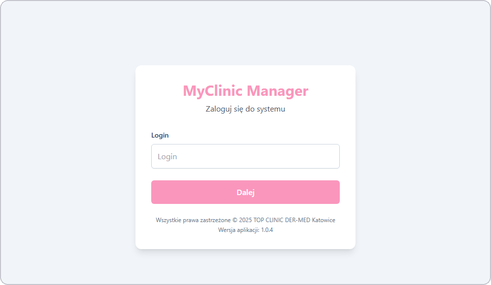
</p>

<h1 align="center">MyClinic Manager</h1>

<h3 align="center">System full-stack do zarządzania kliniką medycyny estetycznej</h3>

<p align="center">
  <em>Do rzeczywistej pracy kliniki - śledzenie sprzedaży, analiza kosztów, prowizje i analityka.</em>
</p>

<p align="center">
  
  
  
  
  
  
</p>

---

## Spis treści

- [O projekcie](#o-projekcie)
- [Moja rola](#moja-rola)
- [Zrzuty ekranu](#zrzuty-ekranu)
- [Kod źródłowy](#kod-źródłowy)
- [Stack](#stack)
- [Funkcje](#funkcje)
- [Architektura](#architektura)
- [Statystyki](#statystyki)
- [Kontakt](#kontakt)

---

## O projekcie

**MyClinic Manager** to produkcyjna aplikacja dla **TOP CLINIC DER-MED Katowice**, prawdziwej kliniki medycyny estetycznej. Obsługuje całą codzienną pracę, którą wcześniej robiono na papierze albo w arkuszach: rejestrowanie sprzedaży, katalogi usług i materiałów, śledzenie prowizji lekarzy i analizę rentowności.

System działa jako responsywna aplikacja webowa i jako aplikacja na Androida (przez Capacitor). Personel kliniki korzysta z niego na co dzień w trzech rolach: Administrator, Manager i User.

---

## Moja rola

Zbudowałem MyClinic Manager.

---

## Zrzuty ekranu

### Na komputerze

| Logowanie | Pulpit |
|:---:|:---:|
|  | 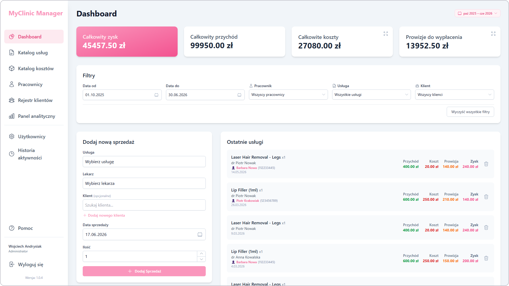 |

| Katalog usług | Dodawanie usługi |
|:---:|:---:|
| 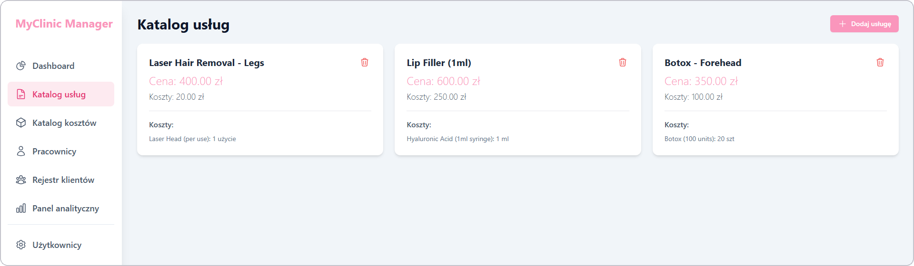 | 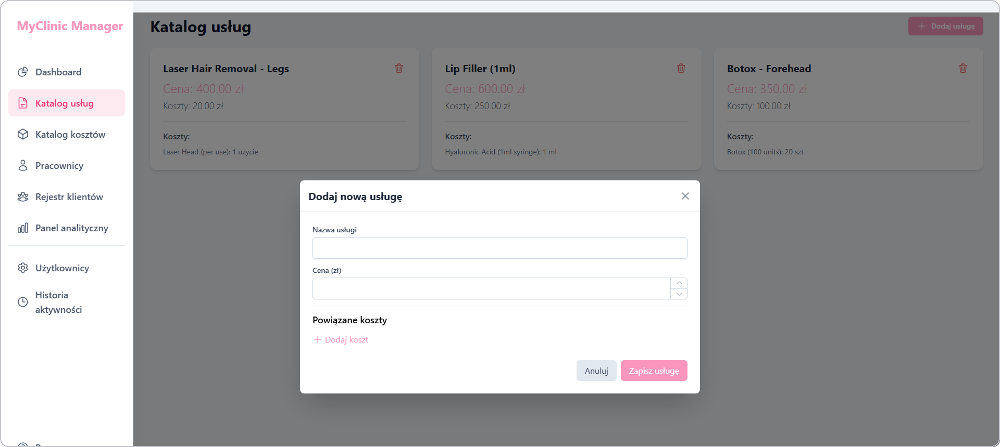 |

| Katalog kosztów | Dodawanie kosztu |
|:---:|:---:|
| 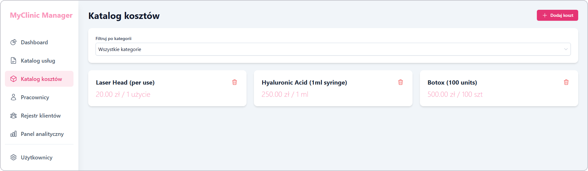 | 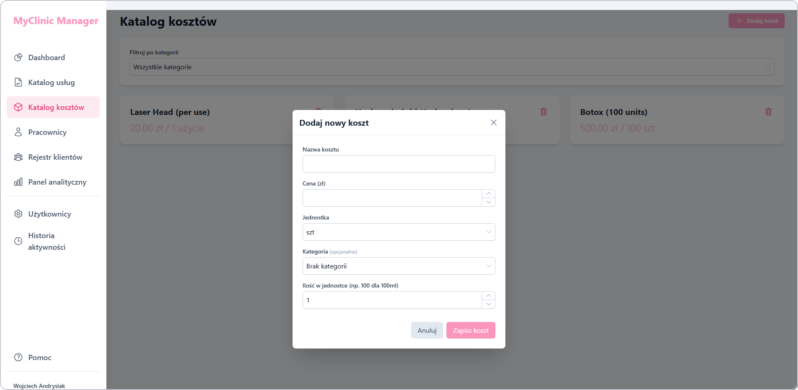 |

| Pracownicy | Dodawanie pracownika |
|:---:|:---:|
| 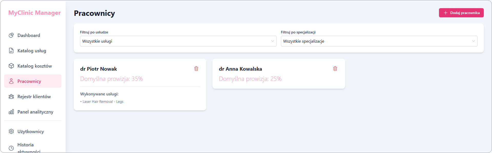 | 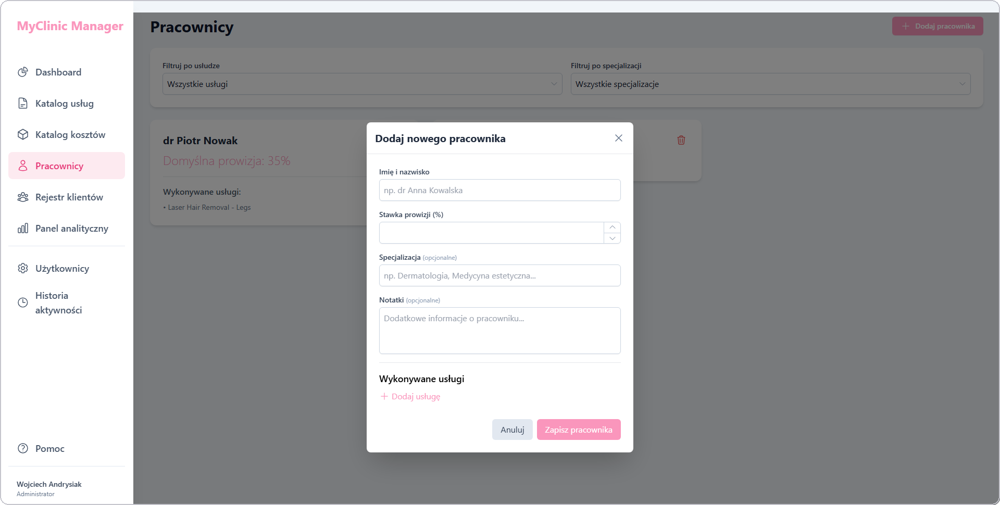 |

| Rejestr klientów | Dodawanie klienta |
|:---:|:---:|
| 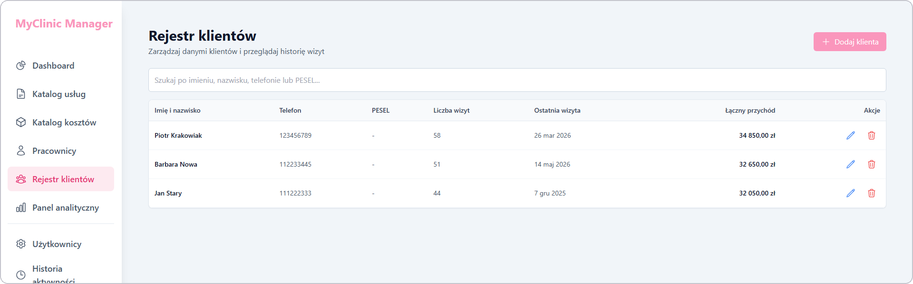 | 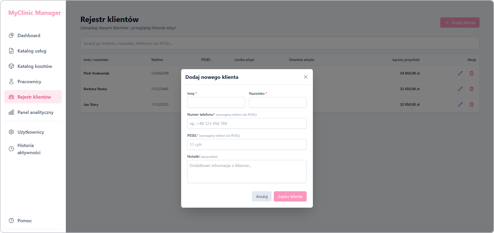 |

| Panel analityki |
|:---:|
| 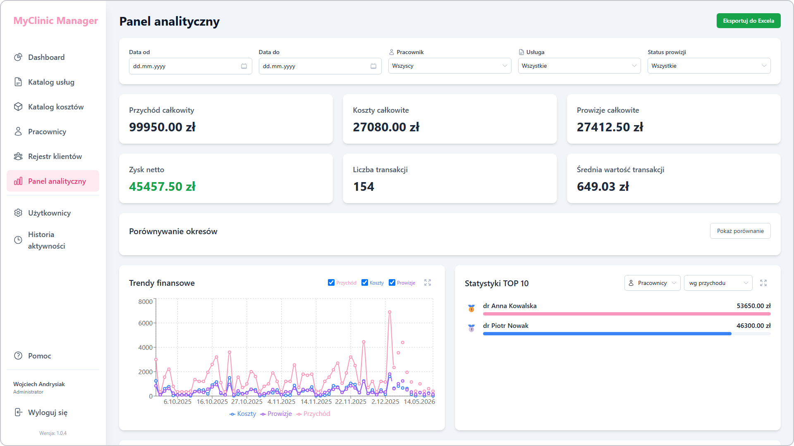 |

### Na telefonie

| Pulpit | Nawigacja |
|:---:|:---:|
| 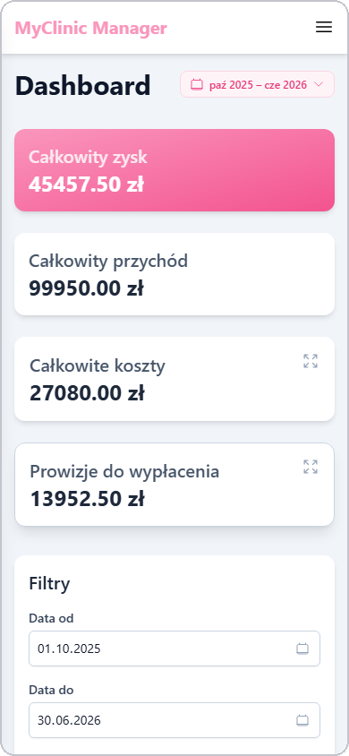 | 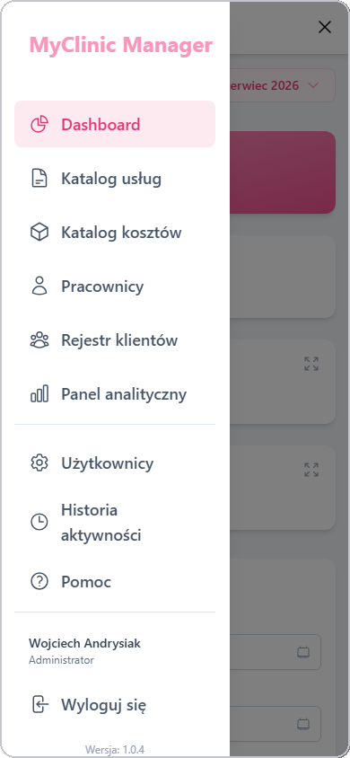 |

> **Uwaga:** Wszystkie dane na zrzutach są fikcyjne i powstały wyłącznie na potrzeby prezentacji. Imiona, nazwiska, dane finansowe i pozostałe szczegóły są zmyślone i nie dotyczą prawdziwych osób ani rzeczywistej dokumentacji kliniki.

---

## Kod źródłowy

> Kod źródłowy jest prywatny.

---

## Stack

### Interfejs

```
React 19 + TypeScript 5.8   // interfejs aplikacji, statyczne typowanie
Vite 6                      // HMR poniżej sekundy, szybki build produkcyjny
Tailwind CSS 3.4            // responsywne style
Recharts 3.5                // wykresy w panelu analityki
```

### Android

```
Capacitor 8                 // jedna baza kodu na przeglądarkę i Androida (~95% wspólne)
```

### Baza

```
Supabase (PostgreSQL)       // baza, RLS, funkcje RPC i dane w czasie rzeczywistym
Custom RPC + bcrypt auth    // rate limiting, sprawdzanie ról, obowiązkowe ustawienie hasła
ExcelJS 4.4                 // eksport do Excela na raporty offline
```

### Stan

```
React Context API           // stan globalny bez dodatkowych bibliotek
Hash routing                // nawigacja działająca w WebView Capacitora
```

---

## Funkcje

### Pulpit
- **Karty KPI** - zysk netto, przychód, koszty i prowizje widać od razu.
- **Filtry** - filtrowanie po zakresie dat, pracowniku, usłudze albo kliencie.
- **Szybkie dodanie sprzedaży** - dodawanie sprzedaży wraz z utworzeniem klienta w tym samym miejscu.
- **Historia transakcji** - ostatnia aktywność widoczna zależnie od roli.

### Katalogi
- **Usługi** - cennik, powiązane koszty materiałów i marża na usługę.
- **Koszty** - materiały i środki zużywalne z ceną jednostkową i kategoriami.
- **Pracownicy** - domyślna stawka prowizji, osobna stawka dla każdej usługi i specjalizacje.

### Klienci
- **Rejestr klientów** - wyszukiwanie po imieniu i nazwisku, telefonie albo PESEL.
- **Historia wizyt** - śledzenie wizyt i łącznego przychodu z klienta.

### Analityka (tylko Administrator)
- **Trendy finansowe** - interaktywne wykresy liniowe przychodu, kosztów i zysku.
- **Porównanie okresów** - porównanie wyników z różnych zakresów czasu.
- **Rankingi TOP 10** - pracownicy, usługi i klienci według przychodu.
- **Eksport do Excela** - pobieranie szczegółowych tabel transakcji.

### Bezpieczeństwo
- **Dostęp według ról** - role Administrator, Manager i User.
- **Konta** - zakładanie kont i reset haseł.
- **Pełny dziennik audytu** - każda zmiana danych jest zapisywana i oznaczana czasem.
- **Pomoc kontekstowa** - wbudowana pomoc ze wskazówkami zależnymi od roli.

### Telefon
- **Responsywny układ** - dopasowuje się od komputera do telefonu.
- **Wysuwana nawigacja** - boczne menu wygodne w dotyku.
- **APK na Androida** - ten sam kod i natywne odczucie dzięki Capacitor.

---

## Architektura

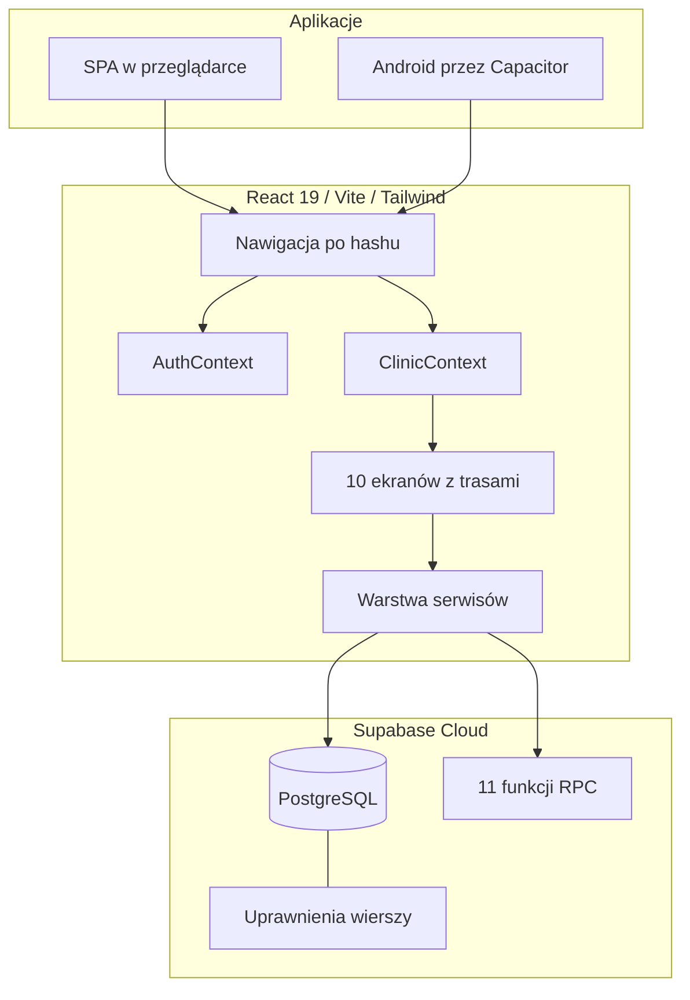

---

## Statystyki

### Złożoność techniczna

| Metryka | Liczba |
|---|---|
| **Komponenty React** | ~50+ |
| **Ekrany aplikacji** | 10+ |
| **Tabele w bazie** | 9 |
| **Funkcje RPC w Supabase** | 11 |
| **Metody warstwy serwisów** | ~48 |
| **Role użytkowników** | 3 |

### Przegląd funkcji

| Kategoria | Najważniejsze |
|---|---|
| **Wprowadzanie danych** | sprzedaż, usługi, koszty, pracownicy, klienci |
| **Analityka** | wykresy, porównanie okresów, TOP 10, eksport do Excela |
| **Bezpieczeństwo** | uprawnienia według ról, dziennik audytu, uwierzytelnianie z limitem żądań |
| **Telefon** | APK na Androida przez Capacitor |

---

## Kontakt

| Platforma | Link |
|---|---|
| **Email** | [wandrysiak.it@gmail.com](mailto:wandrysiak.it@gmail.com) |
| **GitHub** | [wandrysiak](https://github.com/wandrysiak) |

---

<p align="center">
  <strong>MyClinic Manager</strong> - aplikacja, z której klinika korzysta na co dzień.
  <br/><br/>
  Wojciech Andrysiak
</p>
